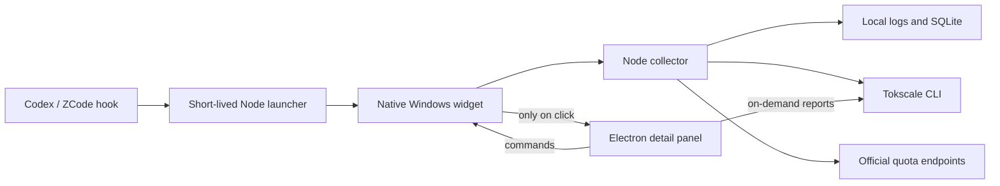

# Architecture

The widget uses a Windows Forms native HWND, GDI+ text/images rendered to a premultiplied-alpha surface, `UpdateLayeredWindow`, and a Windows 11 DWM Acrylic backdrop. No browser renderer or Chromium GPU helper is started for the widget. DWM still uses the operating system's graphics compositor; this is not a claim that the visual effect requires no GPU work.

The collector runs under the standalone Node 24 runtime with a newline-delimited JSON protocol. It retains the same Tokscale, Codex and ZCode adapters as the web-only implementation. Source credentials are only used in memory for the documented official quota requests.

The native host owns child processes through a Windows Job Object with `JOB_OBJECT_LIMIT_KILL_ON_JOB_CLOSE`. The collector, reports and an explicitly opened panel are descendants of that job. Closing the host releases the entire owned tree. Client applications and their unrelated hooks are not assigned to this job.

The native host owns the event pipe, active task identities, session/turn matching and the three-second exit delay. It writes atomic, local snapshots for an explicitly opened web panel. The panel reads snapshots only while open and routes settings/lifecycle commands back to the native host. Closing a manually opened panel allows the host to exit if no tasks remain.

The collector emits only changed state. Native drawing happens on actual state or UI changes. The web panel reconciles existing DOM nodes rather than replacing the entire tree on every update. Codex log parsing uses bounded 64 KiB reads, a 1 MiB per-file budget per poll, a bounded line tail, and UTF-8 boundary handling. Oversized tool output lines are discarded; supported token records are parsed separately.

Widget mode refreshes today's data every roughly thirty seconds and full history periodically. Opening the panel requests a full-history refresh. The canonical historical parser remains Tokscale and is not limited to the two clients with live lifecycle adapters.

Maple Mono CN subsets and official product icons are local assets. The native font files are loaded privately; the web panel uses WOFF2. No fonts are registered with Windows or fetched from a CDN at runtime.

`--legacy` retains the previous Electron-hosted widget only for development and A/B diagnostics. Normal manual launch and client hooks use the native host. `--native-panel` starts only the full panel client.

See the README for build and hook setup. Local diagnostic outputs, configuration backups, usage records and credentials are excluded from the public source repository.
